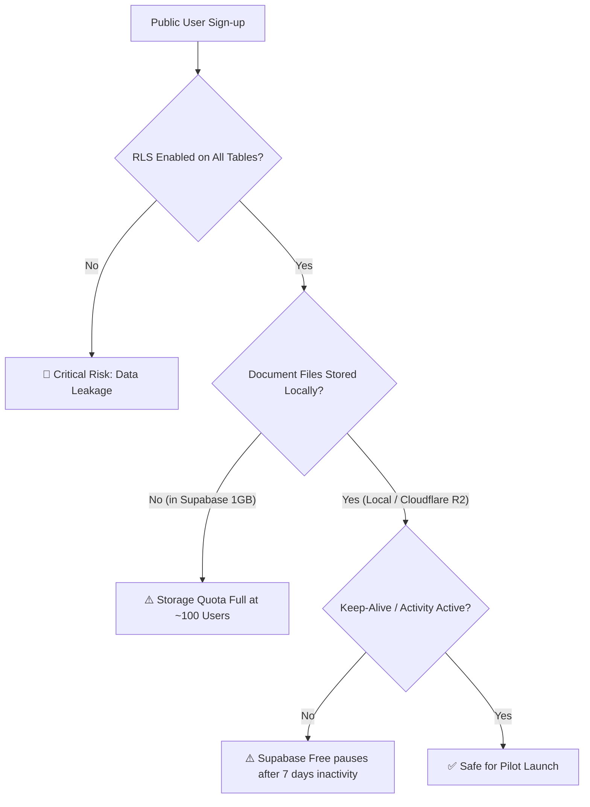
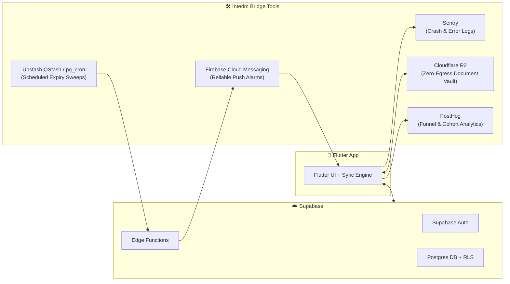
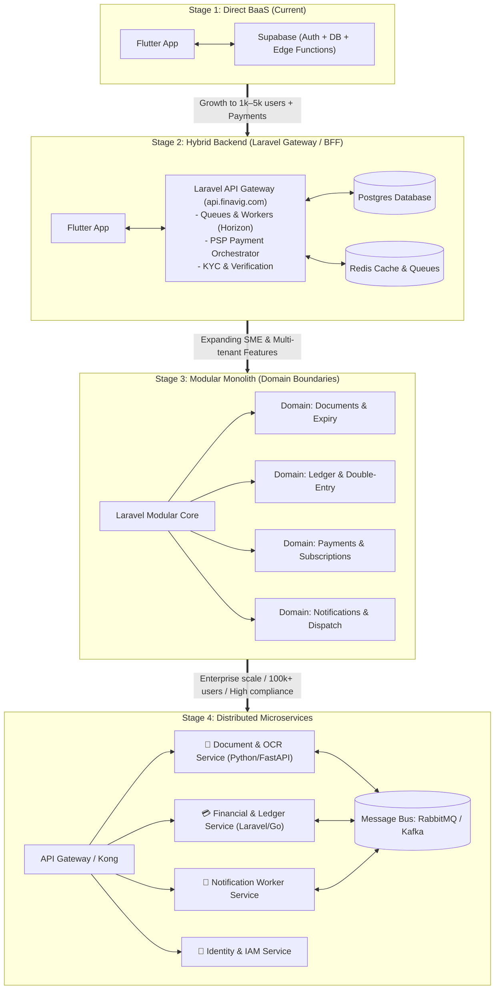
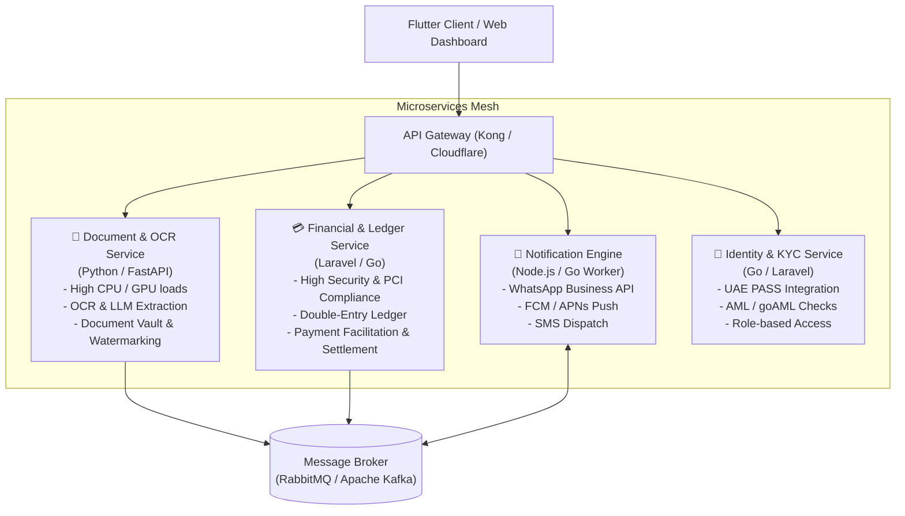

# Finavig System Architecture Evolution & Scaling Blueprint

**Author:** Antigravity / Finavig Engineering  
**Date:** November 2026  
**Target Platform:** Finavig (Flutter + Supabase → Laravel Backend → Microservices)  
**Scope:** Initial User Onboarding, Supabase Limits, Interim Bridge Tools, and Multi-Stage Architectural Roadmap  

---

## Executive Summary

| Question | Short Answer | Action / Recommendation |
|---|---|---|
| **Is it OK to onboard initial users with only Flutter + Supabase?** | **YES, absolutely.** | Ideal for pilot & first 500–1,000 users. Local-first design minimizes server load. Fix 2 critical safeguards (RLS audit + Supabase pause prevention) before launch. |
| **How many users can the Supabase Free plan support?** | **~2,000 – 5,000 active users** (if document files remain device-local or compressed). | Limits: 50k MAU, 500 MB DB, 1 GB Storage, 500k Edge Function calls. Upgrading to Pro ($25/mo) unlocks 8 GB DB and 100k+ users. |
| **What tools/tech are needed in-between (interim)?** | **Sentry, FCM/OneSignal, Cloudflare R2, pg_cron / QStash, PostHog.** | Fills the gaps for crash monitoring, reliable scheduled push notifications, cheap file storage, and product analytics without spinning up servers yet. |
| **What is the future architectural plan?** | **4-Phase Evolution:**<br>1. Flutter + Supabase BaaS<br>2. Dedicated Backend (Laravel Modular Monolith)<br>3. Event-Driven Services<br>4. Microservices (Documents, Ledger, Payments). | Do **not** jump straight to microservices. Start with Flutter + Supabase, transition to Laravel as business logic (payments/KYC) grows, and split into microservices only at high scale. |

---

## 1. Onboarding Initial Users with Flutter + Supabase

### 1.1 Why It Is the Right Choice for Day 0 – Day 90
Finavig is already engineered with a **local-first architecture**:
1. **Local storage & sync outbox (`doc_sync.dart`):** Reads and writes happen locally first; synchronization with Supabase happens asynchronously when online.
2. **Offline resilience:** The app functions completely without network connectivity or when unauthenticated (`local-only mode`).
3. **Security isolation:** Supabase Postgres handles authentication and Row-Level Security (RLS) enforcement per user (`auth.uid() = owner_id`).
4. **AI Protection:** The `groq-proxy` Edge Function already guards the LLM API key and meters per-tier quotas server-side.
5. **Speed to market:** You avoid maintaining server infrastructure, devops pipelines, operating system updates, or database clusters while validating Product-Market Fit (PMF).

### 1.2 Critical Safeguards Before Opening Public Onboarding
Before inviting public or pilot users, ensure these 4 operational risks are handled:



1. **Verify Row Level Security (RLS) on Every Table:**
   - Run: `SELECT tablename, rowsecurity FROM pg_tables WHERE schemaname = 'public';`
   - Every single table (`documents`, `finance_transactions`, `collections`, `user_tiers`, `credit_entries`) must have `rowsecurity = true` and policies restricting `SELECT`, `INSERT`, `UPDATE`, `DELETE` to `auth.uid() = owner_id`.
2. **Prevent the 7-Day Inactivity Pause:**
   - On the Supabase Free plan, projects with **no API requests for 7 consecutive days are paused**.
   - *Mitigation:* Set up a free external ping (e.g., GitHub Actions cron or UptimeRobot) making 1 authenticated read to an Edge Function or health table every 48 hours.
3. **Keep Document Scans Device-Local (or Compressed):**
   - Storing full-resolution PDF/image scans in Supabase Storage will exhaust the 1 GB free quota in weeks.
   - Keep files on the phone's local storage (Finavig's current default), uploading only metadata (expiry dates, amounts, issuer names) to Postgres.
4. **Error Monitoring Integration:**
   - Flutter errors and network sync failures must be captured via Sentry or Firebase Crashlytics so you know when users encounter bugs.

---

## 2. Supabase Free Plan Capacity Analysis

### 2.1 Supabase Free Plan Limits (Current Specs)

| Resource | Free Tier Quota | What Consumes It in Finavig |
|---|---|---|
| **Monthly Active Users (MAU)** | **50,000 MAUs** | User sign-ups and logins (Auth JWT) |
| **Postgres Database Size** | **500 MB** | Document metadata, transactions, audit logs, indexes |
| **File Storage** | **1 GB** (50 MB max per file) | Document attachments (PDFs, ID scans, receipts) |
| **Bandwidth (Egress)** | **5 GB / month** | API responses, database queries, file downloads |
| **Edge Function Invocations** | **500,000 / month** | AI OCR proxies (`groq-proxy`), quota checks, webhooks |
| **Realtime Connections** | **200 concurrent** | Live sync sockets (not required if polling/outbox sync) |
| **Database Compute / RAM** | Shared Micro (~1 GB RAM) | Connection limits (~60 direct, pooled via Supavisor) |
| **Project Pausing** | Pauses after **7 days** inactivity | Needs at least 1 ping per week |

### 2.2 Realistic User Capacity for Finavig

#### Model A: Local-First Files (Recommended for Launch)
*Document scans stay on device; only metadata + ledger sync to Supabase.*
- User profile & tier row: ~1 KB
- 20 documents with OCR metadata: ~20 KB
- 100 financial transactions & ledger rows: ~50 KB
- Database indexes and Postgres overhead: ~30 KB
- **Average Database footprint per user:** **~100 KB**

$$\text{User Capacity} = \frac{500\text{ MB}}{100\text{ KB/user}} \approx \mathbf{5,000\text{ active users}}$$

* **Auth capacity:** 50,000 MAU (well above database capacity).
* **AI Invocations:** 500,000 Edge Function calls. At 25 AI queries per user/month = **20,000 users**.
* **Verdict:** You can easily onboard **2,000 to 5,000 active users** on the Supabase Free plan.

#### Model B: Full Cloud Storage of Document Scans
*Users upload 3 to 5 document scans (Trade Licence, Passport, Emirates ID, Tenancy contract) directly to Supabase Storage.*
- Scanned PDF / High-res camera image: ~2 MB each.
- 5 documents per user = **10 MB per user**.

$$\text{User Capacity} = \frac{1,000\text{ MB}}{10\text{ MB/user}} \approx \mathbf{100\text{ users}}$$

* **Verdict:** If you store raw files on Supabase Free storage, you will hit limits after just **~100 to 150 users**.
* **Solution:** Keep files local, or connect **Cloudflare R2** for file attachments.

### 2.3 What Happens When You Outgrow the Free Plan?
Upgrading to **Supabase Pro is $25 / month**:
- Database: **8 GB** included (up to 80,000+ users).
- Storage: **100 GB** included.
- Egress: **250 GB** included.
- MAUs: **100,000 MAUs**.
- **No pausing** — 99.9% uptime SLA and daily automated backups.

---

## 3. Recommended Interim Bridge Stack (Between BaaS and Custom Server)

Before building a full custom backend server, you can add lightweight, high-leverage tools that solve immediate operational needs without server maintenance.



### 1. Crash Reporting & Observability: **Sentry** (or Firebase Crashlytics)
- **Why:** You cannot see user devices. If a background sync fails or a database schema mismatch occurs, you need instant stack traces.
- **Finavig status:** `ErrorCaptureService` in `lib/services/` is already structured to forward errors. Wire it to `sentry_flutter`.

### 2. Push Notifications & Scheduled Alerts: **Firebase Cloud Messaging (FCM)**
- **Why:** On Android (Xiaomi, Samsung, Oppo), local OS notifications are frequently suppressed by aggressive OEM battery-savers.
- **How it works:** A lightweight serverless cron triggers an Edge Function daily, queries documents expiring in 90/60/30/7 days, and dispatches a high-priority push via FCM/APNs.

### 3. Document File Storage: **Cloudflare R2** (S3-Compatible)
- **Why:** Cloudflare R2 has **zero egress fees** and provides 10 GB free storage.
- **How it works:** The Flutter app requests a presigned upload URL from an Edge Function, then uploads directly to R2. Supabase Postgres only stores the R2 object URL.

### 4. Background Job Scheduling: **Supabase pg_cron + pg_net** (or Upstash QStash)
- **Why:** For executing scheduled jobs (e.g., checking daily renewal deadlines, generating weekly budget summaries, cleaning expired tokens) without running a long-lived 24/7 server.

### 5. Product Analytics: **PostHog**
- **Why:** Generous free tier (1,000,000 events/month). Tracks user conversion through the onboarding funnel, which document categories are most added, and where drop-offs happen.

---

## 4. Architectural Evolution: 4-Stage Roadmap



---

### Stage 1: Current Architecture — Client + BaaS (0 to 1,000 Users)

* **Components:** Flutter Mobile Client + Supabase (Postgres, Auth, RLS, Storage, Edge Functions).
* **Traffic Flow:**
  - App reads/writes directly to Supabase via PostgREST with user JWT.
  - Edge Functions handle secret operations (`groq-proxy` AI requests, webhook endpoints).
* **When to stay here:** Day 1 to validation. Fast, zero infrastructure overhead, $0 hosting cost.
* **What breaks first:**
  - Complex multi-step business logic (e.g., checkout flows, merchant reconciliation, split transactions).
  - RLS policies become complex and slow as joins increase.
  - Client-side code cannot be trusted with financial calculations or tier enforcement.

---

### Stage 2: Dedicated Backend Server using Laravel (1,000 to 50,000 Users)

#### Why Laravel is an Excellent Choice for Finavig:
1. **Financial & Ledger Integrity:**
   - Database transactions (`DB::transaction`) with strict ACID guarantees.
   - Battle-tested double-entry accounting libraries (e.g., `bkwld/clerk` or custom ledger models).
2. **Queues & Asynchronous Processing:**
   - **Laravel Horizon + Redis:** Perfect for handling heavy background jobs (e.g., bulk OCR document scanning, PDF invoice generation, reminder notifications).
3. **Payment & Subscription Ecosystem:**
   - Built-in billing architectures (Laravel Cashier / Omnipay / custom drivers for Checkout.com, PayTabs, Tabby, Tamara).
   - Webhook processing with automatic signature verification and retry mechanisms (`spatie/laravel-stripe-webhooks` pattern).
4. **SME & Multi-Tenancy Management:**
   - Easy organizational permissions, corporate multi-seat accounts, and audit logging (`spatie/laravel-permission`, `spatie/laravel-activitylog`).
5. **Scheduled Task Engine:**
   - Unified crontab (`schedule:run`) running daily sweeps across all GCC document expiries.

#### How the Hybrid Transition Works:
- Keep the Postgres database (you can continue using Supabase Postgres or point Laravel to it directly).
- The Flutter app transitions its API calls from Supabase PostgREST to `https://api.finavig.com/v1/...`.
- Laravel handles business-heavy operations:
  - `POST /api/v1/renewals/initiate`
  - `POST /api/v1/payments/webhook`
  - `POST /api/v1/documents/ocr-process`
  - `GET /api/v1/financial-health`
- Auth can remain Supabase Auth (Laravel validates the Supabase JWT using public keys), or migrate to Laravel Sanctum / Passport.

---

### Stage 3: Modular Monolith (50,000 to 200,000 Users)

Before splitting into microservices, organize the Laravel codebase into **Internal Domain Modules (Domain-Driven Design)**:

```
app/
├── Domains/
│   ├── Documents/             # Expiry calculations, OCR pipelines, catalogs
│   │   ├── Actions/
│   │   ├── Models/
│   │   └── Services/
│   ├── Finance/               # Ledger, double-entry, budgets, credit book
│   │   ├── Actions/
│   │   ├── Models/
│   │   └── Services/
│   ├── Payments/              # PSP connectors, virtual cards, invoices
│   │   ├── Drivers/           # Checkout.com, Tabby, Tamara
│   │   └── Webhooks/
│   └── Notifications/         # Multi-channel delivery (WhatsApp, FCM, SMS)
```

#### Why Modular Monolith Before Microservices:
- **Single deployment pipeline:** One test suite, one CI/CD pipeline, single database.
- **No distributed transaction headaches:** Transfers between accounts and document status changes succeed or fail atomically in one SQL transaction.
- **Fast developer velocity:** A small team (1–5 engineers) can move 5x faster than managing 10 microservice repositories.

---

### Stage 4: Microservices Architecture (200,000+ Users / Enterprise / Regulated Scale)

When Finavig reaches high scale, handles regulated banking/card-issuing APIs, or requires independent scaling teams, decouple into dedicated services:



#### Breakdown of Dedicated Services:

| Service | Best Technology | Responsibility & Isolation Reason |
|---|---|---|
| **Document & OCR Service** | Python (FastAPI / Celery) | Machine learning, OpenCV image enhancement, Groq/Gemini OCR extraction, PDF parsing. Scales independently on CPU/GPU instances without affecting the main API. |
| **Financial & Ledger Service** | Go or Laravel | PCI-DSS compliant, CBUAE regulatory audit boundaries. Immutable financial ledgers, idempotent payment execution, bank reconciliation. |
| **Notification Engine** | Node.js or Go | High-throughput async message dispatch. Manages WhatsApp Business API rate limits, SMS fallbacks, and FCM push notifications. |
| **Identity & Compliance Service** | Go or Laravel | UAE PASS authentication, identity verification (KYC/AML), consent ledger recording under UAE PDPL. |

---

## 5. Architectural Comparison Matrix

| Criteria | Stage 1: Flutter + Supabase | Stage 2: Laravel Monolith | Stage 4: Microservices |
|---|---|---|---|
| **User Capacity** | 0 – 5,000 users | 5,000 – 100,000+ users | 250,000 – Millions |
| **Monthly Infra Cost** | **$0** (Free) → **$25** (Pro) | **$50 – $250** (VPS/RDS + Redis) | **$1,000 – $5,000+** (K8s/AWS) |
| **Team Size Needed** | 1 Solo Developer | 1 – 3 Developers | 6 – 15+ Developers / DevOps |
| **Deployment Complexity** | Low (push migrations & functions) | Moderate (Docker, Forge, GitHub Actions) | High (Kubernetes, Service Mesh, CI/CD) |
| **Transaction Safety** | Basic (Edge Functions + SQL) | Excellent (`DB::transaction`, ACID) | Complex (Saga patterns, event eventual consistency) |
| **Fintech / Payment Ready** | Limited (Edge Functions proxy) | High (Native SDKs, webhooks, audit logs) | Enterprise / Bank-Grade |

---

## 6. Strategic Advice: What Should You Do Right Now?

1. **Launch with Current Flutter + Supabase Stack:**
   - Onboard your initial pilot users (family, founders, first 100–500 businesses).
   - Keep document scan bytes stored locally on device storage (as currently built).
   - Maintain the Supabase Free plan until you reach ~1,000 users or hit the 500 MB limit.
2. **Add the Low-Hanging Interim Bridge Tools:**
   - Plug **Sentry** into `ErrorCaptureService` to capture production crashes.
   - Hook up **Firebase Cloud Messaging (FCM)** for guaranteed daily renewal alerts.
3. **Introduce Laravel when Building Phase 1 Embedded Payments:**
   - When you begin processing real card payments (trade licence renewals, BNPL via Tabby/Tamara), spin up a clean **Laravel API**.
   - Let Laravel handle webhook reconciliation, idempotent ledger entries, and payment receipts.
   - Point Laravel at your existing Postgres database to preserve all user records.
4. **Resist Premature Microservices:**
   - Do **not** split into microservices now. Microservices solve organizational team-scaling problems; at early stage, they add network latency, distributed bugs, and high server bills.
   - Build a well-structured **Modular Monolith** first; extract microservices only when specific components (like heavy OCR processing) demand independent scaling.
