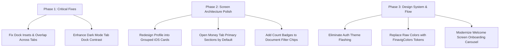

# Finavig Mobile App — UI/UX Audit & Improvement Recommendations

**Date**: 19 October 2026  
**Target Platform**: Flutter Mobile (iOS & Android)  
**Evaluated Device**: iPhone 17 Pro Simulator (iOS 26.3)  
**Status**: Comprehensive Assessment  

---

## Executive Summary

An in-depth UI/UX evaluation of the Finavig mobile application was conducted across all core tabs, sub-features, design tokens, navigation structures, and onboarding workflows. Finavig exhibits a strong design foundation with its four-quadrant brand identity, bento tiles, and airy cards. However, several high-impact layout conflicts, visual hierarchy issues, and component inconsistencies need to be addressed to elevate the application to a tier-1 fintech standard.

---

## 1. High-Impact Structural & Layout Issues

### 1.1 Floating Bottom Pill Dock Insets & Overlap
* **Location**: [`lib/router.dart`](file:///Users/raziquemk/Desktop/finavig/lib/router.dart#L300-L386)
* **Problem**:
  * In `_AppShell`, `extendBody: true` is configured with a floating bottom navigation dock (`height: 56` + margins).
  * On scrollable views (specifically `ProfileScreen`, `MoneyScreen`, and `HomeScreen`), content at the bottom of the viewport is partially obscured or cut in half behind the translucent dock.
  * In `ProfileScreen`, the "AI Summary" row sits directly behind the pill on first render, and remaining settings rows require unintuitive scrolling without a clear bottom boundary.
* **Recommendations**:
  * Standardize a unified bottom scroll inset constant:
    ```dart
    static const double kFloatingDockBottomInset = 96.0;
    ```
  * Apply `kFloatingDockBottomInset + MediaQuery.paddingOf(context).bottom` uniformly to the bottom of all scrollable lists in `HomeScreen`, `MoneyScreen`, `DocumentsScreen`, and `ProfileScreen`.
  * Ensure a soft gradient scrim or sufficient overscroll breathing room so list items never look trapped behind the dock.

### 1.2 Dark Mode Active Tab Contrast in Navigation Dock
* **Location**: [`lib/router.dart`](file:///Users/raziquemk/Desktop/finavig/lib/router.dart#L518-L524) (`_NavPillItem`)
* **Problem**:
  * Active tab icon color in dark mode is `Colors.white`.
  * Inactive tab icon color in dark mode is `Colors.white.withValues(alpha: 0.65)`.
  * 100% white vs 65% white provides insufficient contrast ratio on an OLED display, making it difficult for users to discern the active tab at a glance.
* **Recommendations**:
  * Lower inactive icon opacity in dark mode to `0.38`–`0.45` alpha:
    ```dart
    fade.color(FinavigColors.textMutedLight, Colors.white.withValues(alpha: 0.40))
    ```
  * Alternatively, add a subtle pill indicator plate or accent tint behind the active tab icon.

---

## 2. Screen-by-Screen UI/UX Improvements

### 2.1 Profile / Settings Tab ([`lib/screens/profile_screen.dart`](file:///Users/raziquemk/Desktop/finavig/lib/screens/profile_screen.dart))

| Issue | Current State | Recommended Improvement |
| :--- | :--- | :--- |
| **List Structure** | 14 standalone floating pills separated by 10px gaps, creating excessive scroll length. | Group into 4 clean iOS/Fintech styled grouped container cards (Account, Preferences, Support, Danger Zone). |
| **User Name Display** | Forced to uppercase (`.toUpperCase()` $\rightarrow$ `MKRAZIQUE`). | Render in Title Case (e.g. `Mkrazique` or `Razique Mk`) for a natural, refined appearance. |
| **Sign-Out Action** | Top-right header button with export-style icon (`Icons.logout_rounded` in a pale blue circle). | Reposition Sign-Out as a distinct, low-priority text row at the bottom of the settings screen. |
| **Avatar Customization** | Static NFT asset (`assets/images/nft_avatar.jpg`) with no user customization. | Add initials avatar fallback with an option to select or update profile image. |

### 2.2 Money Tab ([`lib/screens/money_screen.dart`](file:///Users/raziquemk/Desktop/finavig/lib/screens/money_screen.dart))

| Issue | Current State | Recommended Improvement |
| :--- | :--- | :--- |
| **Accordion Over-Collapsing** | All 10 sections (`budgets`, `pace`, `weekly`, `categories`, `top`, `recurring`, `envelopes`, `credit`, `transactions`) start minimized. | Keep high-priority actionable sections **expanded by default** (*Budgets & Pace*, *Recent Transactions*). Keep secondary analytics collapsible. |
| **Hero Action Pills** | Three flat pills (`Transactions`, `Budgets`, `Envelopes`) in the dark hero card. | Enhance with clear touch states, micro-shadows, and haptic feedback. |
| **Spike Alert Cards** | Uses deprecated `.withOpacity()` and hardcoded `Colors.orange.shade900`. | Migrate to `FinavigColors.warning` and `withValues(alpha: ...)`. |

### 2.3 Home Tab ([`lib/screens/home_screen.dart`](file:///Users/raziquemk/Desktop/finavig/lib/screens/home_screen.dart))

| Issue | Current State | Recommended Improvement |
| :--- | :--- | :--- |
| **Stacked Alert Banners** | Multiple banners (`FirstRunGuideBanner`, `PlanRestrictionBanner`, `HomeAttentionBanner`, `HomeExpiredAlert`) can stack vertically and push content offscreen. | Consolidate stacked alert banners into an expandable single-banner stack or alert carousel. |
| **Bento Grid Typography** | Bento category tile labels (12px / 10px) can feel vertically compressed on compact displays. | Relax internal tile padding (`EdgeInsets.symmetric(horizontal: 8, vertical: 10)`) and optimize label line-height. |

### 2.4 Documents Tab ([`lib/screens/documents_screen.dart`](file:///Users/raziquemk/Desktop/finavig/lib/screens/documents_screen.dart))

| Issue | Current State | Recommended Improvement |
| :--- | :--- | :--- |
| **Filter Chip Counts** | Filter chips (*All*, *Critical*, *Upcoming*, *Later*, *Expired*) don't indicate item counts until selected. | Embed real-time count badges inside chip labels (e.g. `Critical (2)`, `Upcoming (5)`). |
| **Empty State Visual** | Plain text when search or filters return zero matches. | Add contextual empty-state illustrations with a 1-tap "Clear Filters" button. |

### 2.5 Document Detail & Scan Screens ([`lib/screens/document_detail_screen.dart`](file:///Users/raziquemk/Desktop/finavig/lib/screens/document_detail_screen.dart))

| Issue | Current State | Recommended Improvement |
| :--- | :--- | :--- |
| **Hardcoded Raw Colors** | Uses raw `Colors.red`, `Colors.orange`, `Colors.green` for days remaining badges ([L279-282](file:///Users/raziquemk/Desktop/finavig/lib/screens/document_detail_screen.dart#L279-L282)). | Route through `FinavigColors.urgencyColor(daysRemaining)` and `FinavigColors.urgencyBg(...)`. |
| **Standard AppBar vs Brand Canvas** | Standard Material `AppBar` clashes slightly with the soft wash canvas of the rest of the app. | Use a transparent modern sliver app bar with blurred background (`BackdropFilter`). |

---

## 3. Onboarding & Theme Transition Workflow

### 3.1 First-Launch Theme Flashing
* **Current Experience**:
  1. `SplashScreen`: Pure White canvas (`Colors.white`)
  2. `WelcomeScreen`: Pure White canvas (`Colors.white`)
  3. `LoginScreen`: Locked Dark Navy theme (`Colors.obsidian` / `FinavigColors.ink`)
  4. `HomeScreen`: Light theme default (`FinavigColors.snowWhite`)
* **Problem**: Transitioning from pure white $\rightarrow$ pitch dark $\rightarrow$ snow white creates visual flicker and eye strain on launch.
* **Recommendation**:
  * Allow `LoginScreen` to adapt to system brightness (light/dark) using `FinavigTransition`.
  * Ensure unified brand background wash across `WelcomeScreen`, `LoginScreen`, and `SplashScreen`.

### 3.2 Welcome Screen Value Proposition
* **Current Experience**: WhatsApp-style fake quote dialogue with Warren Buffett and Benjamin Franklin.
* **Recommendation**: Replace with a modern interactive feature walkthrough carousel demonstrating Finavig's three core pillars:
  1. **Smart Document Expiry Radar** (Never miss a passport, trade license, or visa renewal).
  2. **Cash Flow & Envelopes** (Automated budget pacing and recurring expense predictions).
  3. **AI Compliance & Insights** (Camera OCR scanning and automated expense summaries).

---

## 4. Codebase & Design System Cleanliness

* **Color Function Modernization**:
  * Replace deprecated `Color.withOpacity(double)` instances across `screens/money/`, `screens/document_detail_screen.dart`, and `screens/ai_summary_screen.dart` with Flutter 3.27+ `Color.withValues(alpha: double)`.
* **Centralize Typography & Radii**:
  * Ensure all cards consume `FinavigRadius.card` (`16.0`) and `FinavigRadius.tile` (`14.0`) rather than arbitrary `BorderRadius.circular(6 / 8 / 12)`.

---

## Implementation Priority Roadmap


